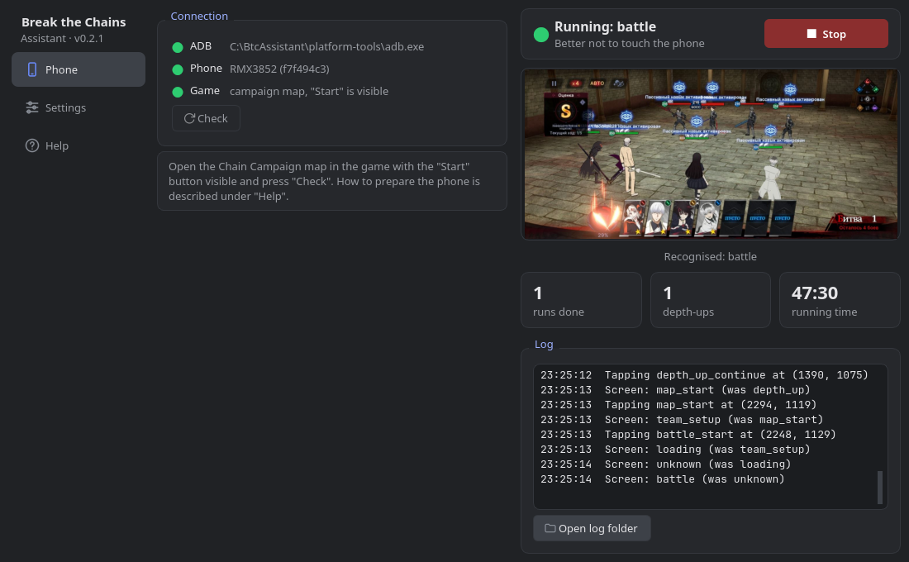

# Break the Chains Assistant

**English** | [Русский](README.ru.md)

> ⚠️ **Beta.** The app is pre-1.0 — a few rough edges are expected. Please
> report bugs and ideas in the [issues](https://github.com/xvin84/tk_btc_assistant/issues).

An auto-runner for the **Chain Campaign** in *Tokyo Ghoul: Break the Chains* on
an Android phone. The game's built-in auto-battle fights; the app moves from
battle to battle:

1. presses "Start" on the campaign map;
2. presses "START" in the team setup;
3. keeps "AUTO" switched on during battles;
4. taps "Tap to continue" after a victory;
5. collects "Claim all", closes the rewards window and the depth-up banner;
6. repeats until stamina runs out or the chosen number of runs is done.



**On defeat** the bot stops and (optionally) closes the game. **When stamina
runs out** it simply stops. It never taps an unfamiliar screen; if such a
screen stays for more than 90 seconds, the bot stops and saves a screenshot.

> [!WARNING]
> This is an unofficial app, not affiliated with the game's developers. The
> bot only looks at the screen and taps through ADB — it does not touch the game
> client or its traffic. Still, automation breaks the rules of most games, and
> **the risk of an account ban is not zero**. Use at your own risk.

## Limitations

- The game must be set to **Russian**: the bot recognises screens by their
  captions. The app itself speaks Russian and English.
- Tested on one phone with a 2780×1264 screen. On phones with a different
  aspect ratio some screens may not be recognised — send screenshots then (see
  "If something goes wrong").
- Android only. You need a computer (Windows, Linux or macOS) and a cable (or
  Wi-Fi debugging). Running right on the phone via Termux also exists but has
  not been tested yet.

## Installation

Download the archive for your system from the
[Releases](https://github.com/xvin84/tk_btc_assistant/releases/latest) page:

- **Windows** — `BtcAssistant-…-windows.zip`. Unzip it anywhere and run
  `BtcAssistant.exe`. The app is not signed, so Windows may show "Windows
  protected your PC": click "More info" → "Run anyway".
- **Linux** (x86_64) — `BtcAssistant-…-linux-x86_64.tar.gz`. Unpack it and run
  `BtcAssistant/BtcAssistant`. Built on Ubuntu 22.04, runs on newer distros too.
- **macOS** (Apple Silicon) — `BtcAssistant-…-macos-arm64.zip`. Unzip it and move
  `BtcAssistant.app` to Applications. The app is not signed: the first time,
  right-click it → "Open" → "Open". On Intel Macs run it from source.

If there is no adb on the computer, the app offers to download it with the
"Download adb" button: it is the official Android platform-tools from Google.

Settings, logs and the downloaded adb are kept next to the program; on macOS
(and when that folder is read-only) — in `~/Library/Application Support/BtcAssistant`
or `~/.local/share/BtcAssistant`.

## Preparing the phone

1. Settings → About phone → tap "Build number" 7 times to enable developer mode.
2. Settings → Developer options: enable **"USB debugging"**.
   - Xiaomi/POCO: also **"USB debugging (Security settings)"**, otherwise taps won't go through.
   - OnePlus/realme/OPPO: if taps don't go through, enable "Disable permission monitoring".
3. In the same menu enable **"Stay awake"** and keep the phone charging.
4. Connect the cable (USB mode "File transfer") and allow debugging for this
   computer on the phone — preferably with "Always allow".

Over Wi-Fi (Android 11+): Developer options → "Wireless debugging" → "Pair
device with pairing code", then `adb pair IP:port` and `adb connect IP:port`
in a terminal.

## Usage

1. Open the **Chain Campaign** map in the game, with the "Start" button visible.
2. On the "Phone" tab press **"Check"**. All three rows should turn green, and
   the "Game" row should read 'campaign map, "Start" is visible'.
3. On the "Settings" tab choose how many runs to do: "While stamina lasts" or a
   fixed number. A run is one campaign stage; the bot doesn't care how many
   battles it has.
4. The first time, enable **"Dry run"** there and play one run by hand. The bot
   taps nothing and only logs what it sees and where it would tap.
5. Turn dry run off and press **"Start"**. The same button stops the bot at any
   moment. Better not to touch the phone while the bot works.

The right side of the window shows the phone screen, what the bot recognised,
runs done, depth-ups and the action log. The interface language is switched on
the "Help" tab.

## If something goes wrong

Press "Open log folder": every run has its `bot.log` and a `frames/stop_*.jpg`
frame with the screen the bot stopped on. Open an
[issue](https://github.com/xvin84/tk_btc_assistant/issues/new/choose) and attach
them. If the bot doesn't recognise some screen, enable "Save frames" and run
again: the folder will then have a frame of every screen. There is a separate
issue template for such frames, "The bot doesn't recognise a screen".

Version history is in [CHANGELOG.en.md](CHANGELOG.en.md).

---

## Running from source

You need **[uv](https://docs.astral.sh/uv/)** and **adb** (or the "Download
adb" button in the window).

```bash
git clone https://github.com/xvin84/tk_btc_assistant.git
cd tk_btc_assistant
uv sync
uv run btc-bot gui        # the window
uv run btc-bot doctor     # or the command line: check the phone
```

`uv sync` creates a `.venv` and installs the dependencies from `uv.lock`; the
system Python is left alone. The window is built with Qt (PySide6), which uv
installs too. On Debian/Ubuntu Qt may need `sudo apt install libxcb-cursor0`.

adb on Linux: Arch `sudo pacman -S android-tools`, Debian/Ubuntu
`sudo apt install adb`. If `adb devices` says `no permissions`, you need udev
rules (the `android-udev` package on Arch), then reconnect the cable.

### Command line

```bash
uv run btc-bot doctor                # connection, phone, current screen
uv run btc-bot run --dry-run         # dry run
uv run btc-bot run                   # until stamina runs out
uv run btc-bot run --max-runs 3      # three runs and stop
uv run btc-bot run --save-frames     # plus a frame on every screen change
```

Stop with Ctrl+C. The log and frames of every run go to `logs/<date>/`.
Settings (limits, timeouts, whether to close the game) live in `config.toml`;
`config.example.toml` is a commented template. The window reads the same
`config.toml` and remembers its own switches in `gui.json`. The command line
speaks Russian.

### Running right on the phone (Termux)

> [!NOTE]
> This mode has **not been tested** on a real phone yet: the tests pass, but
> nobody has run it in Termux. If you try it, tell us in an issue how it went.

The bot can run on the phone itself, without a computer. The code is the same:
[Termux](https://termux.dev) gets Python, numpy and Pillow, and the phone's adb
connects to itself at `127.0.0.1:5555`. OpenCV is not needed on the phone:
without it the bot matches screens with numpy, with the same scores.

1. Install **Termux** from F-Droid or GitHub (the Google Play build is outdated),
   optionally **Termux:API** (a notification when the bot stops) and
   **Termux:Widget** (a home-screen button).
2. In Termux:
   ```bash
   pkg install -y git
   git clone https://github.com/xvin84/tk_btc_assistant.git
   cd tk_btc_assistant
   bash termux/setup.sh               # Python, numpy, Pillow, adb
   ```
3. Termux → Battery → **"Unrestricted"**; Developer options → **"Disable child
   process restrictions"** (Android 14+; on Android 12–13 run
   `adb shell settings put global settings_enable_monitor_phantom_procs false`
   once from a computer); **"Stay awake"** with the phone charging.
4. Connect adb to itself once after every reboot: either run `adb tcpip 5555`
   from a computer and then `python -m btc_bot connect` in Termux, or pair with
   wireless debugging (`python -m btc_bot pair <port> <code>` once, then
   `python -m btc_bot connect` after every reboot).
5. Open the campaign map, return to Termux and run `bash termux/btc-bot.sh`
   (or the **BtC-bot** widget). Arguments go to `run`, e.g.
   `bash termux/btc-bot.sh --max-runs 20`.

The step-by-step version with all details is in the
[Russian README](README.ru.md#запуск-прямо-на-телефоне-termux).

### Recording screenshots

Used to collect screens the bot doesn't know yet: defeat, dialogs, the
out-of-stamina window.

```bash
uv run btc-bot record                 # a screenshot on every touch
uv run btc-bot record --interval 2    # plus one every 2 seconds
uv run btc-bot record --no-taps --interval 1   # timer only
uv run btc-bot snap defeat            # one screenshot of the current screen
```

Recordings go to `recordings/<date>/`: `tap_0001.jpg` (the screen right before
the touch), `annotated/tap_0001.jpg` (the same with the touch circled) and
`taps.jsonl` (touch coordinates). If the circle is off, add `--rotation 3` (or `1`).

## How recognition works

A phone frame is scaled to a working width of 1280 px. Templates in
`templates/` — captions and buttons of every screen — are cut at that scale;
`templates/manifest.json` describes them and their sources. The "which screen
is this" rules are in `btc_bot/screens.py`.

The templates are cut from compressed screenshots (`samples/phone_1280/`). To
make them sharper, put a full-size screenshot with the same name next to them
(e.g. `map_start.png` from `snap`) and run `uv run btc-bot rebuild-templates`.

A new template, e.g. for the defeat screen:

```bash
uv run btc-bot classify samples/device/defeat.png --scores   # what the bot sees
uv run btc-bot crop samples/device/defeat.png 70 95 320 165 --name defeat_title
```

The bot picks up `defeat_title` by itself: the defeat rule already exists.

## Development

```bash
uv run pytest
```

The tests run recognition on every sample and simulate runs on screenshots:
a full run, defeat, running out of stamina, auto-battle switched off. The window
is tested too: headless (Qt offscreen) it goes through a run on a fake phone and
stops with the button.

Building the app (PyInstaller; the built app matches screens with numpy and
Pillow, without OpenCV):

```bash
uv sync --group build
uv run pyinstaller packaging/btc-bot.spec --noconfirm   # → dist/BtcAssistant/
```

Releases are built by GitHub Actions (`.github/workflows/release.yml`). To
release a version, bump it in `pyproject.toml` and `btc_bot/__init__.py`, add a
section to `CHANGELOG.md` and `CHANGELOG.en.md`, then:

```bash
git tag v0.3.0
git push origin v0.3.0
```

A few minutes later archives for Windows, Linux and macOS appear on the Releases
page, and the release text is built from the changelogs (`scripts/release_notes.py`).

### What's next

- templates for defeat, dialogs and the stamina window (screenshots needed);
- custom battle logic instead of the auto-battle: card picking and merging, Weak,
  attributes. Notes on the mechanics are in [`docs/GAME_NOTES.md`](docs/GAME_NOTES.md) (Russian).

## License

[MIT](LICENSE). Tokyo Ghoul and Tokyo Ghoul: Break the Chains belong to their
respective owners. Screenshots and templates cut from them are in the repository
only for screen recognition.
