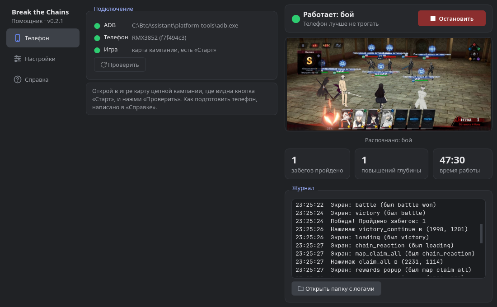

# Помощник для Tokyo Ghoul: Break the Chains

[English](README.md) | **Русский**

> ⚠️ **Бета-версия.** Программа ещё до 1.0 — возможны шероховатости. Пишите об
> ошибках и идеях в [issues](https://github.com/xvin84/tk_btc_assistant/issues).

Программа для автопрохождения **цепной кампании** на Android-телефоне. Бои
ведёт встроенный автобой игры, а программа переходит от боя к бою:

1. на карте нажимает «Старт»;
2. в «Расстановке» нажимает «СТАРТ»;
3. в бою следит, чтобы «АВТО» был включён;
4. после победы нажимает «Нажмите, чтобы продолжить»;
5. собирает «Получить все», закрывает окно наград и баннер повышения глубины;
6. повторяет, пока не кончится стамина или заданное число забегов.



**При поражении** бот останавливается и (по желанию) закрывает игру.
**Если стамины не хватает**, бот просто останавливается. На незнакомом экране
он ничего не нажимает; если такой экран висит дольше 90 секунд, бот
останавливается и сохраняет скриншот.

> [!WARNING]
> Это неофициальная программа, не связанная с разработчиками игры.
> Бот смотрит только на экран и нажимает через ADB, в клиент игры не лезет и
> трафик не трогает. Но автоматизация нарушает правила большинства игр, и
> **риск блокировки аккаунта не нулевой**. Пользуешься на свой страх и риск.

## Ограничения

- Игра должна быть на **русском языке**: бот узнаёт экраны по надписям. Сама
  программа говорит по-русски и по-английски.
- Проверено на одном телефоне с экраном 2780×1264. На телефонах с другим
  соотношением сторон что-то может не распознаваться. Тогда пришли
  скриншоты (см. «Если что-то пошло не так»).
- Только Android. Нужен компьютер (Windows, Linux или macOS) и кабель (или
  отладка по Wi-Fi). Есть и запуск прямо на телефоне через Termux, но он пока
  не проверялся.

## Установка

Скачай архив для своей системы со страницы
[Releases](https://github.com/xvin84/tk_btc_assistant/releases/latest):

- **Windows** — `BtcAssistant-…-windows.zip`. Распакуй в любую папку и запусти
  `BtcAssistant.exe`. Программа не подписана, поэтому Windows может показать
  «Система Windows защитила ваш компьютер»: нажми «Подробнее» → «Выполнить в
  любом случае».
- **Linux** (x86_64) — `BtcAssistant-…-linux-x86_64.tar.gz`. Распакуй и запусти
  `BtcAssistant/BtcAssistant`. Собрано на Ubuntu 22.04, на более новых
  дистрибутивах тоже работает.
- **macOS** (Apple Silicon) — `BtcAssistant-…-macos-arm64.zip`. Распакуй и
  перенеси `BtcAssistant.app` в «Программы». Программа не подписана: в первый
  раз нажми на неё правой кнопкой → «Открыть» → «Открыть». На маках с Intel —
  запуск из исходников.

Если на компьютере нет adb, программа предложит скачать его кнопкой
«Скачать adb»: это официальный набор Android platform-tools с сайта Google.

Настройки, логи и скачанный adb хранятся рядом с программой; на macOS (и если
в эту папку нельзя писать) — в `~/Library/Application Support/BtcAssistant`
или `~/.local/share/BtcAssistant`.

## Подготовка телефона

1. Настройки → О телефоне → 7 раз нажми «Номер сборки»: включится режим разработчика.
2. Настройки → Для разработчиков: включи **«Отладка по USB»**.
   - Xiaomi/POCO: ещё **«Отладка по USB (настройки безопасности)»**, иначе нажатия не пройдут.
   - OnePlus/realme/OPPO: если нажатия не проходят, включи «Отключить мониторинг разрешений».
3. Там же включи **«Не выключать экран»** (при зарядке) и держи телефон на зарядке.
4. Подключи кабель (режим USB «Передача файлов») и разреши на телефоне отладку
   для этого компьютера. Лучше с галочкой «Всегда разрешать».

По Wi-Fi (Android 11+): «Для разработчиков» → «Беспроводная отладка» →
«Подключить по коду», затем в командной строке `adb pair IP:порт` и
`adb connect IP:порт`.

## Как пользоваться

1. Открой в игре карту **цепной кампании**, где видна кнопка «Старт».
2. На вкладке «Телефон» нажми **«Проверить»**. Все три строки должны стать
   зелёными, а в строке «Игра» должно быть «карта кампании, есть «Старт»».
3. На вкладке «Настройки» выбери, сколько забегов пройти: «Пока есть
   стамина» или конкретное число. Забег — один этап кампании, сколько в нём
   боёв, боту неважно.
4. В первый раз включи там же **«Пробный режим»** и пройди один забег руками.
   Бот ничего не нажимает, только пишет в журнал, что видит и куда нажал бы.
5. Выключи пробный режим и нажми **«Запустить»**. Остановить можно той же
   кнопкой в любой момент. Пока бот работает, телефон лучше не трогать.

Справа в окне видно экран телефона, что бот распознал, сколько забегов
пройдено, сколько раз выросла глубина, и журнал действий. Язык интерфейса
(русский или английский) меняется на вкладке «Справка».

## Если что-то пошло не так

Нажми «Открыть папку с логами»: там лог `bot.log` каждого запуска и кадр
`frames/stop_*.jpg` с экраном, на котором бот остановился. Создай
[issue](https://github.com/xvin84/tk_btc_assistant/issues/new/choose) и приложи их.
Если бот не узнаёт какой-то экран, включи «Сохранять кадры» и запусти ещё
раз: тогда в папке будет кадр каждого экрана. Для таких кадров есть отдельный
шаблон issue «Бот не узнаёт экран».

История версий — в [CHANGELOG.md](CHANGELOG.md).

---

## Запуск из исходников

Нужен **[uv](https://docs.astral.sh/uv/)** и **adb** (или кнопка «Скачать
adb» в окне).

```bash
git clone https://github.com/xvin84/tk_btc_assistant.git
cd tk_btc_assistant
uv sync
uv run btc-bot gui        # окно
uv run btc-bot doctor     # или командная строка: проверить телефон
```

`uv sync` создаёт окружение `.venv` и ставит туда зависимости из `uv.lock`.
Системный Python он не трогает.

Окно сделано на Qt (PySide6), uv поставит его сам. На Debian/Ubuntu Qt может
попросить системную библиотеку: `sudo apt install libxcb-cursor0`.

adb на Linux: Arch `sudo pacman -S android-tools`, Debian/Ubuntu
`sudo apt install adb`. Если `adb devices` пишет `no permissions`, нужны
udev-правила (в Arch пакет `android-udev`), потом переподключи кабель.

### Командная строка

```bash
uv run btc-bot doctor                # связь, телефон, текущий экран
uv run btc-bot run --dry-run         # пробный режим
uv run btc-bot run                   # пока не кончится стамина
uv run btc-bot run --max-runs 3      # три забега и стоп
uv run btc-bot run --save-frames     # плюс кадр при каждой смене экрана
```

Остановить можно по Ctrl+C. Лог и кадры каждого запуска лежат в
`logs/<дата>/`. Настройки (лимиты, таймауты, закрывать ли игру) лежат в
`config.toml`, шаблон с пояснениями в `config.example.toml`. Окно читает тот
же `config.toml`, а свои переключатели запоминает в `gui.json`.

### Запуск прямо на телефоне (Termux)

> [!NOTE]
> Этот режим пока **не проверялся** на живом телефоне: тесты проходят, но
> реального запуска в Termux ещё не было. Если попробуешь, напиши в issue,
> как прошло.

Бот может работать на самом телефоне, без компьютера. Код тот же: в
[Termux](https://termux.dev) ставятся Python, numpy и Pillow, а adb телефона
подключается к самому себе по адресу `127.0.0.1:5555`. OpenCV на телефоне не
нужен: без него бот распознаёт экраны через numpy, с теми же оценками.

#### 1. Приложения

Termux ставь **из F-Droid или с GitHub**: версия в Google Play устарела и не работает.

- **Termux** — обязательно;
- **Termux:API** — уведомление в шторку, когда бот остановится;
- **Termux:Widget** — запуск бота кнопкой с рабочего стола.

#### 2. Проект и зависимости

В Termux:

```bash
pkg install -y git
git clone https://github.com/xvin84/tk_btc_assistant.git
cd tk_btc_assistant
bash termux/setup.sh               # Python, numpy, Pillow, adb
```

#### 3. Настройки телефона

- Termux → «Батарея» → **«Без ограничений»**, иначе Android усыпит его ночью.
- «Для разработчиков» → **«Отключить ограничения для дочерних процессов»**
  (Android 14+). Иначе система может убить Python или adb в фоне.
  На Android 12–13 вместо этого один раз с компьютера:
  `adb shell settings put global settings_enable_monitor_phantom_procs false`.
- «Для разработчиков» → **«Не выключать экран»**, телефон на зарядке.

#### 4. Подключить adb к самому себе

Нужно один раз после каждой перезагрузки телефона. Есть два способа.

**С компьютера (проще).** Подключи кабель и выполни на компьютере
`adb tcpip 5555`. Кабель после этого можно отключить. В Termux:

```bash
python -m btc_bot connect
```

На телефоне появится «Разрешить отладку?»: отметь «Всегда разрешать» и нажми «Разрешить».

**Без компьютера (нужен Wi-Fi).** «Для разработчиков» → «Беспроводная отладка» → включить.

1. Один раз сделай сопряжение. Открой Termux и настройки в режиме
   разделённого экрана, там нажми «Подключение устройства с помощью кода».
   Затем в Termux:
   ```bash
   python -m btc_bot pair <порт из окна с кодом> <шестизначный код>
   ```
2. После каждой перезагрузки в Termux:
   ```bash
   python -m btc_bot connect      # порт найдётся сам; если нет: --port <порт>
   ```

`connect` открывает постоянный порт 5555, который живёт до перезагрузки.
Отключать Wi-Fi или беспроводную отладку после этого можно.
На этот порт без твоего «Разрешить» на экране никто не подключится. Но
незнакомые запросы отладки не подтверждай.

#### 5. Запуск

1. Открой игру на карте цепной кампании.
2. Вернись в Termux и запусти `bash termux/btc-bot.sh`. Можно кнопкой
   **BtC-bot** из виджета Termux:Widget.
3. Бот сам выведет игру на передний план и начнёт работу. Аргументы
   передаются в `run`, например `bash termux/btc-bot.sh --max-runs 20`.

Когда бот остановится (лимит, стамина, поражение), придёт уведомление. Лог
лежит в `logs/` внутри проекта. Остановить вручную: открой Termux и нажми
Ctrl+C, или закрой сессию через уведомление Termux («Exit»).

### Запись скриншотов

Нужна, чтобы собрать экраны, которых ещё нет: поражение, диалоги, окно
нехватки стамины.

```bash
uv run btc-bot record                 # скриншот при каждом касании экрана
uv run btc-bot record --interval 2    # плюс скриншот каждые 2 секунды
uv run btc-bot record --no-taps --interval 1   # только по таймеру
uv run btc-bot snap defeat            # один скриншот текущего экрана
```

Запись идёт в `recordings/<дата>/`:

- `tap_0001.jpg`: экран за мгновение до касания;
- `annotated/tap_0001.jpg`: то же, место касания обведено;
- `taps.jsonl`: координаты касаний (экранные и рабочие).

Если кружок стоит не там, где ты нажимал, добавь `--rotation 3` (или `1`).

## Как устроено распознавание

Кадр с телефона уменьшается до рабочей ширины 1280 px. В этом масштабе
вырезаны шаблоны из `templates/`: надписи и кнопки каждого экрана. Их
описание и источники лежат в `templates/manifest.json`. Правила «какой это
экран» описаны в `btc_bot/screens.py`.

Сейчас шаблоны вырезаны из сжатых скриншотов (`samples/phone_1280/`). Чтобы
сделать их точнее, положи туда же полноразмерный скриншот с тем же именем
(например, `map_start.png` из `snap`) и выполни:

```bash
uv run btc-bot rebuild-templates
```

Новый шаблон, например для экрана поражения:

```bash
uv run btc-bot classify samples/device/defeat.png --scores   # что видит бот
uv run btc-bot crop samples/device/defeat.png 70 95 320 165 --name defeat_title
```

Шаблон `defeat_title` бот подхватит сам: правило для поражения уже есть.

## Разработка

```bash
uv run pytest
```

Тесты прогоняют распознавание на всех образцах и имитируют забеги на
скриншотах: полный забег, поражение, нехватку стамины, выключенный автобой.
Окно тоже проверяется: без экрана (Qt offscreen) оно проходит забег на
подставном телефоне и останавливается кнопкой.

Сборка программы с окном (PyInstaller; собранная программа распознаёт экраны
через numpy и Pillow, без OpenCV):

```bash
uv sync --group build
uv run pyinstaller packaging/btc-bot.spec --noconfirm   # → dist/BtcAssistant/
```

Релизы собирает GitHub Actions (`.github/workflows/release.yml`). Чтобы
выпустить версию, подними её в `pyproject.toml` и `btc_bot/__init__.py`, допиши
раздел в `CHANGELOG.md` и `CHANGELOG.en.md`, затем:

```bash
git tag v0.3.0
git push origin v0.3.0
```

Через несколько минут на странице Releases появятся архивы для Windows, Linux и
macOS, а текст релиза соберётся из CHANGELOG (`scripts/release_notes.py`).

### Что дальше

- шаблоны для поражения, диалогов и окна стамины (нужны скриншоты);
- своя боевая логика вместо автобоя: выбор и слияние карт, Weak, атрибуты.
  Заметки по механикам лежат в [`docs/GAME_NOTES.md`](docs/GAME_NOTES.md).

## Лицензия

[MIT](LICENSE). Tokyo Ghoul и Tokyo Ghoul: Break the Chains принадлежат их
правообладателям. Скриншоты и вырезанные из них шаблоны лежат в репозитории
только для распознавания экранов.
